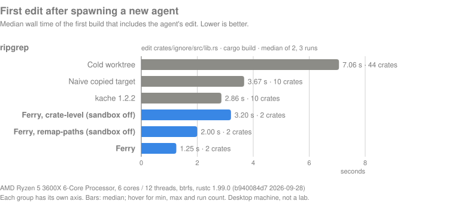

# Ferry

**Parallel agents, one warm build. No cold compiles, no cross-contaminated artifacts.**

[](https://github.com/patwrall/ferry/actions/workflows/ci.yml)
[](https://crates.io/crates/ferry-rs)
[](https://patwrall.github.io/ferry)
[](#license)
[](https://github.com/patwrall/ferry/blob/main/Cargo.toml)

Ferry gives every parallel AI coding agent its own git worktree with an
instantly forked, already-warm Cargo build, so agents stop waiting on cold
compiles and stop corrupting each other's builds.

## The problem

Running several coding agents on one Rust repository means one git worktree
per agent. Then every agent's first `cargo build` or `cargo test` starts cold,
which on a real workspace takes minutes. The obvious fix, pointing every
worktree at one shared `CARGO_TARGET_DIR`, makes builds queue on Cargo's build
lock, and it gives **silently wrong builds**:

1. Agent B edits a file.
2. Agent A edits the same file differently and builds.
3. Agent B builds. Cargo compares source mtimes with its own records, finds
   B's source older than A's fresh artifacts, and rebuilds **0 crates**. B runs
   A's code.

This is not hypothetical. Ferry's test suite reproduces it with plain cargo
(60 of 60 runs) and checks that Ferry agents given the same edits each get
their own code: [`tests/contamination.rs`](tests/contamination.rs).

Ferry forks one immutable warm build per agent instead. Each agent starts
warm, rebuilds only what it changed, and never sees another agent's build
state.

<!-- chart generated by bench/ from measured results -->


<!-- DEMO: terminal recording (GIF or asciinema) of `ferry spawn a1`, `ferry spawn a2`
     and two parallel `ferry run ... -- cargo test` sessions starting warm. -->

## Install

These install methods become available with Ferry's first release:

```sh
# crates.io (the crate is ferry-rs; it installs the `ferry` binary)
cargo install ferry-rs --locked

# Prebuilt binary for Linux or macOS
curl --proto '=https' --tlsv1.2 -LsSf https://github.com/patwrall/ferry/releases/latest/download/ferry-rs-installer.sh | sh

# Homebrew
brew install patwrall/tap/ferry
```

Until then, build from source: `git clone https://github.com/patwrall/ferry && cargo install --path ferry --locked`.

On Ubuntu 24.04 or later, see
[AppArmor on Ubuntu](https://patwrall.github.io/ferry/troubleshooting.html#apparmor-on-ubuntu-2404-and-later).

## Quickstart

Inside your Rust repository:

```sh
ferry doctor          # what this machine supports, and what Ferry will do
ferry init            # optional: write ferry.toml with the defaults
ferry base            # build one immutable warm base for HEAD
ferry spawn a1        # worktree + branch ferry/a1 + forked warm target dir
ferry spawn a2
```

Build in both agents at once:

```sh
ferry run a1 -- cargo test      # terminal 1
ferry run a2 -- cargo test      # terminal 2
```

Or put Ferry's cargo shim first on `PATH` and use plain cargo inside each
worktree. Outside agent worktrees the shim runs the real cargo unchanged:

```sh
export PATH="$(ferry shim):$PATH"
cd ~/.local/share/ferry/worktrees/<repo>-<hash>/a1 && cargo test
```

Then:

```sh
ferry list            # bases and agents, with disk usage
ferry rm a1           # refuses if a1 has uncommitted changes; keeps a branch with commits
ferry gc              # delete bases nothing uses
```

Full walkthrough: [Getting started](https://patwrall.github.io/ferry/getting-started.html).

## Use it with your agent

- **Any agent:** `ferry spawn a1 && ferry run a1 -- <agent>`. The agent runs
  in `a1`'s worktree and every `cargo` it runs builds in `a1`'s target dir.
- **Claude Code:** add Ferry's `WorktreeCreate`, `WorktreeRemove` and
  `SessionStart` hooks to `~/.claude/settings.json`
  ([example](examples/claude-code/settings.json)). Then `claude --worktree`,
  background sessions and subagents with `isolation: worktree` each get a
  Ferry agent with a warm build.
- **Codex:** `ferry run a1 -- codex --cd <worktree>`, or the
  [launcher script](examples/codex/ferry-codex.sh).

Never export `CARGO_TARGET_DIR` into an agent session: agent tools pass their
environment to sub-agents working in other worktrees, which recreates the
shared-target bug. The shim works out the agent from the working directory on
every call, so nothing needs exporting. See
[Agent integrations](https://patwrall.github.io/ferry/agents.html).

## How it works

```text
 ferry base                 bases/<commit>-<fingerprint>/
 (once per commit)            src/     immutable checkout
                              target/  immutable warm build
                                 |
            +--------------------+--------------------+
            |                    |                    |
       ferry spawn a1       ferry spawn a2       ferry spawn a3
            |                    |                    |
       worktree a1          worktree a2          worktree a3     your branches, at host paths
       fork of target       fork of target       fork of target  reflink, overlay layer or copy
            |
       cargo for a1 (via `ferry run a1` or the shim) runs in a1's private
       mount namespace, where
            <store>/mnt/src     shows a1's worktree
            <store>/mnt/target  shows a1's fork
       Every agent builds at these same two paths, so the base's incremental
       state stays valid, and no agent can see another agent's build state.
```

- **Base:** `ferry base` builds one commit's workspace once and never touches
  it again. Refreshing for a newer commit is seeded from the previous base.
- **Fork:** each agent gets a copy-on-write clone of the base's target
  (btrfs, XFS, APFS), or where clones are unavailable an overlayfs upper
  layer over it, or a plain copy. Never hard links: Cargo rewrites some files
  in place.
- **Stamping:** a fresh checkout's files are newer than the base's artifacts,
  so Cargo would rebuild everything. Ferry sets the mtime of each file that is
  provably identical to the base (same blob, mode and bytes) to a fixed old
  time; anything that differs keeps its real mtime and rebuilds.
- **Canonical paths:** rustc's incremental state records absolute paths. On
  Linux each build runs in a private user and mount namespace where every
  agent's worktree and target dir appear at the same two paths, so the first
  edit compiles incrementally. Host paths keep working inside it.

Ferry is not a security sandbox: agents run with your user's full privileges
([`SECURITY.md`](SECURITY.md)). Details:
[How it works](https://patwrall.github.io/ferry/how-it-works.html) and the
[architecture contract](https://patwrall.github.io/ferry/architecture.html).

## Platform support

| Platform | Fork | Builds run | First edit after spawn |
|---|---|---|---|
| Linux with unprivileged user namespaces | reflink, overlay or copy | in a namespace sandbox at canonical paths | incremental reuse |
| Ubuntu 24.04 and later | as above, once the AppArmor profile from `ferry doctor --apparmor-profile` is loaded for a root-owned `ferry` binary | as above; without the profile, at host paths | incremental reuse with the profile; dependency reuse without |
| Containers (Docker's default seccomp blocks namespaces) | reflink or copy | at host paths | dependency reuse |
| macOS | `clonefile` (APFS) or copy | at host paths: no canonical path | dependency reuse; incremental state is lost on the first edit. The experimental remap-paths mode reused 12 of 13 library codegen units after a fork on Linux, against 0 of 13 without; unverified on a real Mac |
| Windows | unsupported | | Ferry does not compile there (compile-time error) |

Incremental reuse means nothing unchanged is rebuilt and an edited crate
recompiles only what changed. Dependency reuse means registry and git
dependencies are not rebuilt, but the workspace's own crates rebuild once
after spawn: without the namespace sandbox any of them may have captured the
base's absolute paths where Cargo cannot see it (a build script or proc macro
reading `CARGO_MANIFEST_DIR`). `ferry doctor` tells you which row you are in.
[Platform support](https://patwrall.github.io/ferry/platforms.html).

## Comparison

| Approach | New worktree | First edit in it | Parallel agents |
|---|---|---|---|
| Plain worktrees, one target dir each | cold build | normal | correct |
| Copied target dir (`cp --reflink`) | dependencies reused; workspace crates rebuild because the fresh checkout looks newer | not incremental: the path changed | correct |
| Shared `CARGO_TARGET_DIR` | warm | depends on the other agents | builds wait on Cargo's lock; one agent can silently get another's code |
| sccache | registry crates hit; workspace crates miss, because the key includes absolute paths | not incremental: sccache does not cache incremental units | correct, with a target dir per worktree |
| kache 1.2.2 | warm: content-addressed `RUSTC_WRAPPER` with path-normalized keys | not incremental: restored artifacts carry no incremental state | correct, with a target dir per worktree |
| **Ferry** | warm, 0 crates rebuilt | incremental on Linux with user namespaces; dependencies only elsewhere | correct: each agent has its own fork |

kache is complementary rather than a competitor: it shares artifacts across
machines, commits and CI through remote stores, which Ferry does not do at
all, while Ferry gives each local agent a private, already-incremental build.
kache's main branch is adding incremental seeding between worktrees. Cargo's
own cross-workspace cache is a 2026 project goal and not usable yet.
[More in the FAQ](https://patwrall.github.io/ferry/faq.html#how-does-ferry-compare-with-sccache-kache-or-plain-worktrees).

## Benchmarks

<!-- BENCH:RESULTS -->

Results for the Ferry binary will be published here and in the
[Benchmarks](https://patwrall.github.io/ferry/benchmarks.html) chapter, with
the hardware, OS, filesystem and toolchain of every run.

Before Ferry was written, a bash prototype measured the approach.
**Prototype (bash) on ripgrep, 2 vCPU:** ripgrep at 6892bc2 (39 crates, debug
`cargo build`), 7 GB RAM, ext4, rustc 1.97.0; the edit adds a documented
function to `crates/ignore`, which forces `ignore` and `ripgrep` to rebuild.
A small workspace on a small machine, so read the ratios and crate counts
more than the absolute times.

| Scenario (new agent, then one edit) | Time | Crates compiled |
|---|---|---|
| Cold worktree, fresh target | 17.1 s | 34 |
| Copied warm target, fresh checkout mtimes | 7.2 s | 9 (spurious) |
| Copied warm target, stamped mtimes, different path | 5.3 s | 2 |
| kache 1.2.2 (warm cache, new worktree) | 5.5 s | 2 |
| Prototype fork (stamped mtimes, canonical path) | 1.75 s | 2 |

## Limitations

- **The incremental win needs Linux user namespaces.** Where they are blocked
  (Ubuntu 24.04+ without the AppArmor profile, Docker's default seccomp
  profile, hardened systems), agents reuse only dependencies: the workspace's
  own crates rebuild once after spawn.
- **Overlay copy-up costs disk where clones are unavailable.** On ext4 and
  tmpfs agents fork with overlay, and an agent's first write to a file copies
  all of it into the agent's upper layer; relinked binaries and incremental
  session files make up most of it. `ferry list` shows each agent's share.
- **Paths that cargo prints in the sandbox do not exist on the host.** Run
  built binaries through `ferry run` or `ferry shell`. Reflink and copy
  targets are also reachable on the host at `ferry env`'s
  `host_target_dir`; an overlay target exists only inside the sandbox.
- **Build scripts that write outside `OUT_DIR`** write into the base's
  checkout, and agents do not get those files. `ferry base` warns when it
  happens.
- **mtime freshness has blind spots.** A file whose new content arrives with
  an old mtime (for example copied with preserved timestamps) can look
  unchanged to Cargo. On nightly, checksum freshness covers rustc's inputs;
  build-script inputs stay mtime-based.
- **macOS has no incremental reuse by default.** The remap-paths mode that
  addresses it is experimental and unverified on a Mac.
- **rust-analyzer per worktree is not addressed.**
- **Claude Code 2.1.305 and later** block nested user namespaces in their
  sandbox unless configured; run the session with `ferry run` or see
  [Claude Code's sandbox](https://patwrall.github.io/ferry/agents/claude-code.html#claude-codes-sandbox).
- **Local only.** Ferry does not share builds across machines.

## FAQ

**Is Ferry a sandbox?** No. It isolates build state, not processes. Agents run
as you, with your files and network.

**Do I need root?** No. `ferry doctor` may suggest `sudo` commands (a sysctl,
or loading the AppArmor profile on Ubuntu) for you to review and run.

**Do I have to commit `ferry.toml`?** No. Ferry reads it from your main
checkout's working tree.

**What happens when main moves on?** Run `ferry base` again. The new base is
seeded from the old one, new agents fork from it, and existing agents keep
theirs.

**Which cargo commands go through Ferry?** Every `cargo` that resolves to the
shim, including `cargo clippy` and `cargo nextest`. Warm what your agents run:
see [Configuration](https://patwrall.github.io/ferry/configuration.html).

More in the [FAQ](https://patwrall.github.io/ferry/faq.html) and
[Troubleshooting](https://patwrall.github.io/ferry/troubleshooting.html).

## Documentation

<https://patwrall.github.io/ferry>: getting started, agent integrations,
configuration and CLI reference, platform support, troubleshooting, and the
architecture contract. Examples are in [`examples/`](examples/).

## Contributing

See [`CONTRIBUTING.md`](CONTRIBUTING.md). Security issues: see
[`SECURITY.md`](SECURITY.md).

## License

Licensed under either of

- Apache License, Version 2.0 ([`LICENSE-APACHE`](LICENSE-APACHE) or
  <https://www.apache.org/licenses/LICENSE-2.0>)
- MIT license ([`LICENSE-MIT`](LICENSE-MIT) or
  <https://opensource.org/licenses/MIT>)

at your option.

Unless you explicitly state otherwise, any contribution intentionally
submitted for inclusion in the work by you, as defined in the Apache-2.0
license, shall be dual licensed as above, without any additional terms or
conditions.
